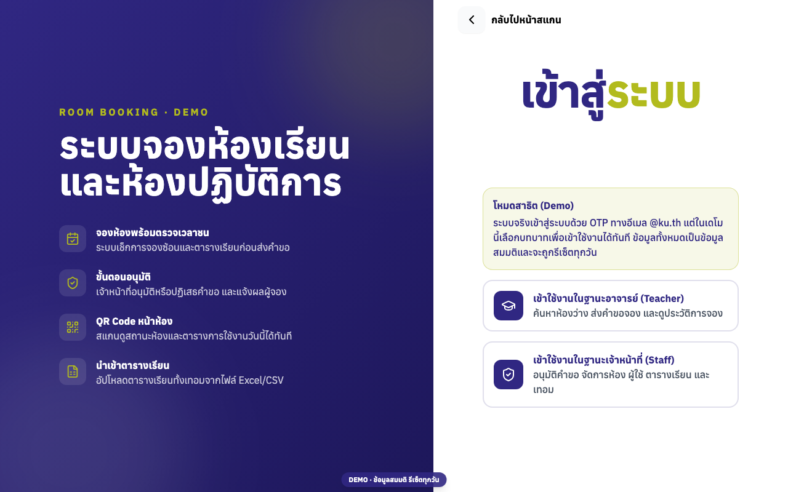
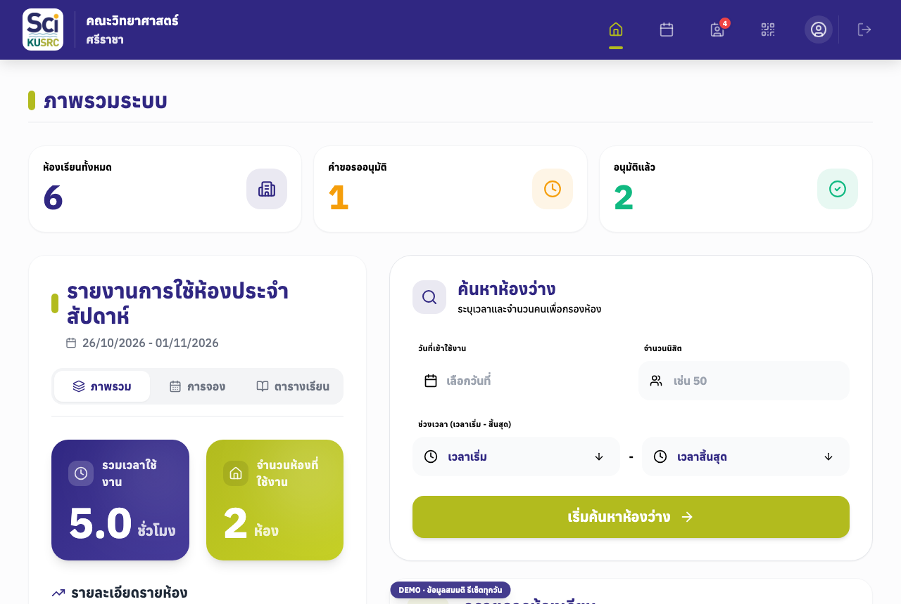
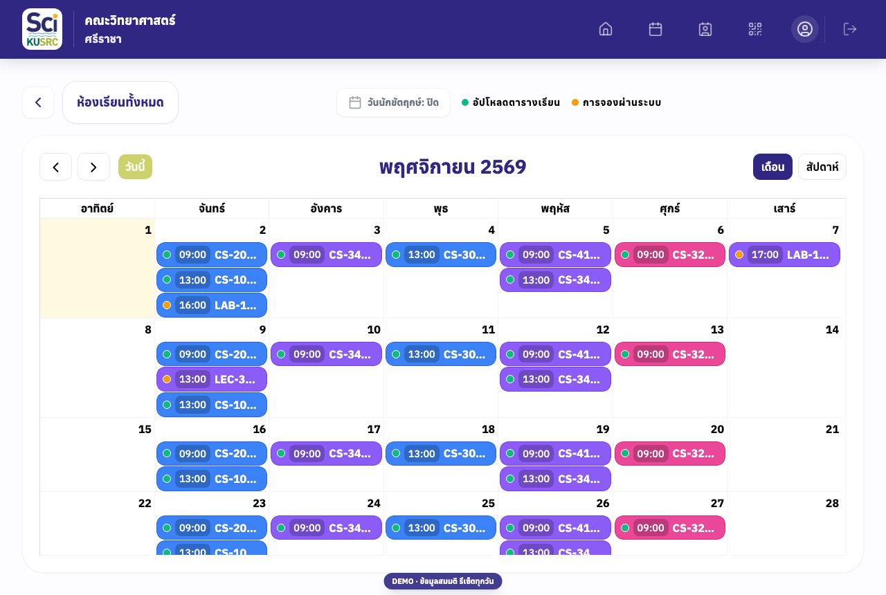
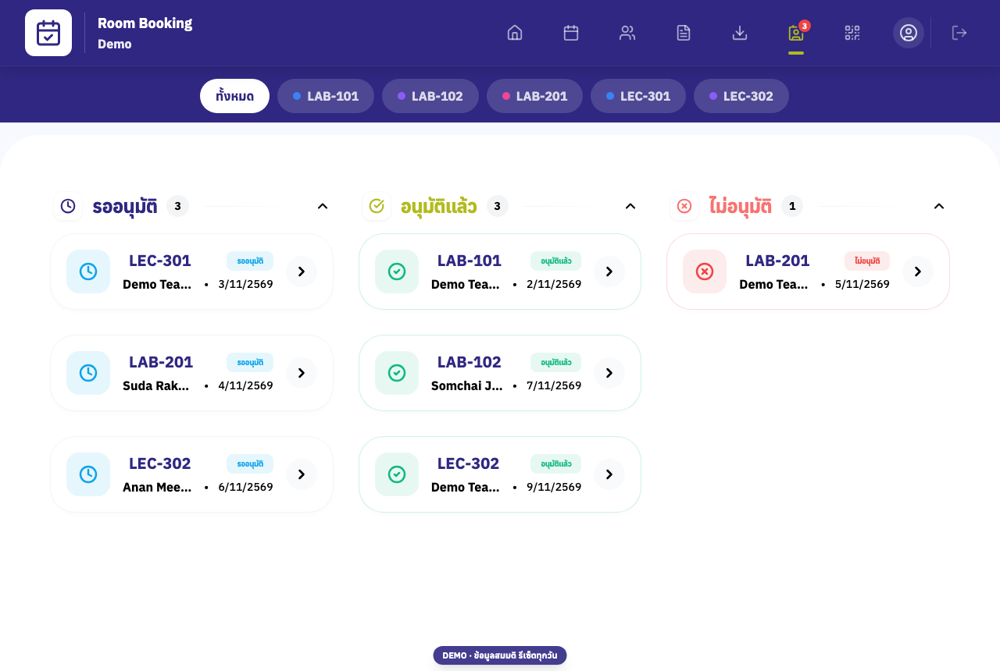
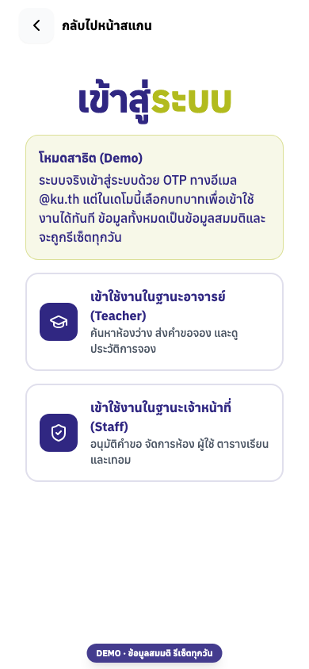
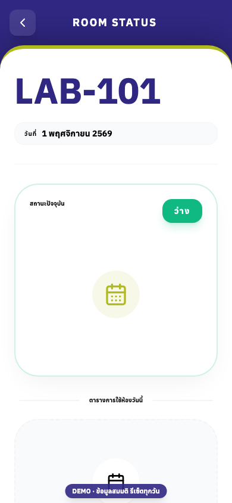

# Campus Room & Facility Booking — Demo

A full-stack room reservation system built for a university faculty: teachers search for free rooms and request bookings, staff approve them, and anyone can scan a room's QR code to see its live status.

This repository is a **public demo build** of the system:

- **Login is bypassed.** The real system signs users in with a one-time password sent to their university e-mail. The demo replaces that step with "sign in as Teacher / Staff" buttons backed by shared demo accounts.
- **All data is fictional** and is reset every night (and whenever the demo server restarts).
- **No e-mail is sent.** Notifications are logged instead.

**Live demo:** https://pongpak-tephee.github.io/roombooking-demo/
(the API runs on a free tier that sleeps when idle, so the first request can take about a minute)



| Dashboard | Calendar | Booking approval |
|---|---|---|
|  |  |  |

| Demo login (mobile) | Room status via QR (mobile) |
|---|---|
|  |  |

## Features

- **Booking with conflict checks:** a booking is rejected when it overlaps an existing booking or a scheduled class, and it must fall inside the configured opening hours, maximum duration and booking window.
- **Approval workflow:** pending → approved / rejected / cancelled → completed, with automatic cancellation of requests that are not approved in time.
- **Calendar view:** classes and bookings per room, by month or week.
- **QR-code room status:** each room has a QR code that opens a public page with its current status and today's schedule; the scanner runs in the browser camera.
- **Class schedule import:** staff upload the term timetable from an Excel/CSV file; bookings that clash with the new timetable are cancelled and the teacher is notified.
- **Role-based access:** `teacher` and `staff` roles, enforced on every API route.
- **Session security (production):** e-mail OTP restricted to the university domain, short-lived access tokens with refresh tokens in HttpOnly cookies, token blacklist on logout, one active session per account, rate limiting and audit logs.
- **Reports:** weekly room-usage summaries and log export.

## Tech stack

| Layer | Tech |
|---|---|
| Frontend | React 19, Vite, React Router, Tailwind CSS, FullCalendar, html5-qrcode, Axios |
| Backend | Node.js, Express 5, PostgreSQL (`pg`), JWT, node-cron, ExcelJS, Nodemailer, Helmet, express-rate-limit, Swagger UI |
| Demo hosting | GitHub Pages (frontend), Render (API + PostgreSQL) |

## Run locally

Requirements: Docker and Node.js 20+.

```bash
# 1. API + PostgreSQL in demo mode (seeds fictional data on start)
docker compose up -d --build

# 2. Frontend
cd frontend
cp .env.example .env.local   # VITE_API_BASE_URL=http://localhost:3000, VITE_DEMO_MODE=true
npm ci
npm run dev                  # http://localhost:5173
```

API docs (Swagger UI): http://localhost:3000/api-docs

To re-seed the database by hand: `cd backend && npm run seed` (uses `DATABASE_URL` from `backend/.env`).

## How the demo mode works

Everything is switched on by `DEMO_MODE=true` (backend) and `VITE_DEMO_MODE=true` (frontend); the production code path is unchanged when they are off.

| Concern | Production | Demo |
|---|---|---|
| Sign-in | `POST /auth/request-otp` → e-mail → `POST /auth/verify-otp` | `POST /auth/demo-login { role }` issues the same JWT + refresh cookie for a demo account |
| Shared accounts | New login replaces the old session | Session is reused, so visitors don't log each other out |
| E-mail | Sent via SMTP | Logged only |
| Demo accounts | — | Can't be edited, suspended or deleted |
| Data | Real database | Fictional seed, reset nightly at 04:00 and on start-up |

Relevant code: [`backend/src/demo/`](backend/src/demo), [`frontend/src/components/auth/DemoLogin.jsx`](frontend/src/components/auth/DemoLogin.jsx).

## Deploy

- **API + database:** Render Blueprint ([`render.yaml`](render.yaml)) → a free web service and a free PostgreSQL database.
- **Frontend:** the [GitHub Pages workflow](.github/workflows/deploy-pages.yml) builds on every push to `main`. Set the repository variable `API_BASE_URL` to the Render service URL.

## Known limitations of the hosted demo

- **Cold start:** the free Render web service sleeps after about 15 minutes without traffic. The first visit after that takes about a minute while the API wakes up; the login page shows a "waking up the server" notice in the meantime.
- **Database expiry:** the free Render PostgreSQL instance expires 30 days after creation (current one: **1 December 2026**). Before then, create a new database (or upgrade the plan), set its *Internal Database URL* as `DATABASE_URL` on the web service, and redeploy — the demo data is re-seeded automatically on start.
- **Shared data:** every visitor uses the same demo accounts, so bookings made by one visitor are visible to others until the nightly reset at 04:00 (server time).
- **Holiday calendar:** public holidays are only shown when `VITE_GOOGLE_CALENDAR_API_KEY` is set at build time; the hosted demo runs without it.
- **Not for real data:** demo mode has no real authentication. Never point a `DEMO_MODE=true` server at a production database, and never commit real credentials — use `.env` files (gitignored) or the hosting provider's environment settings.

## Team

Built as a university project by a two-person team:

- Pongpak Tephee ([@pongpak-TEPHEE](https://github.com/pongpak-TEPHEE))
- [@Boom5556-max](https://github.com/Boom5556-max)

This is a portfolio demo and is not the faculty's official booking system; the faculty's logo, mascot and photos have been removed from this build.
